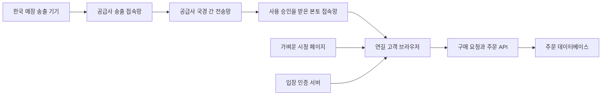

# 한국 매장과 중국 고객을 연결하는 라이브 판매의 도입 가능성

한국 개인사업자가 한국 매장에서 송출하고, 중국 연길 고객 100명 이상이 VPN 없이 일반 브라우저로 시청하는 서비스는 **조건부로 검토할 수 있다.** 공개 문서에서 확인되는 가장 유력한 시험 경로는 중국 본토 접속망을 제공하는 RTC 공급사의 브라우저 SDK다. 다만 한국 개인사업자의 가입·본토 서비스 활성화, 실제 고객 브라우저, 연길 회선 품질까지 확인된 공급사는 아직 없다. 현재 판단은 기술 시험 후보의 존재를 확인한 단계이며, 상용 운영 승인을 뜻하지 않는다.[^3][^4][^5][^6]

Tencent TRTC와 Agora를 같은 조건으로 시험하는 것이 타당하다. TRTC는 본토 활성화의 기업 인증 조건이 명시되어 있어 확인할 관문이 분명하다. Agora는 방송 시청자용 과금이 있어 100명 이상 규모에서 비교 가치가 있지만, 국제계정의 중국 판매 방송 허용 조건을 추가로 확인해야 한다. 자체 재생 도메인을 쓰는 중국 CDN은 ICP 등록 조건이 있어 현지 주체·협력업체가 없는 상태에서 즉시 도입 가능한 경로로 취급하기 어렵다.[^3][^6][^7][^8][^17]

사업 관점에서는 자체 라이브가 방송과 주문을 한 화면에 모으는 데 도움이 될 수 있다. 그러나 기존 더우인 방송을 통한 주문 취합·정산 개선만으로도 해결할 수 있는 업무가 크다. 따라서 현재의 주문 전산화 우선순위는 유지하면서, 자체 라이브는 가입 조건 확인과 제한된 품질 시험을 통해 별도로 판단하는 편이 합리적이다.[^1]

## 1. 운영 조건과 판단 범위

| 항목 | 현재 조건 |
| --- | --- |
| 판매자 | 한국 개인사업자, 실제 판매자는 배우자 |
| 송출 장소 | 한국 매장, 매장을 옮겨 다니는 현장 판매 |
| 고객 | 중국 본토, 주요 도시는 연길로 추정 |
| 접속 | VPN 없이 일반 브라우저 시청이 필수 |
| 규모 | 초기 예상 동시 시청자 100명 이상, 상한은 미정 |
| 현지 기반 | 중국 사업자·협력업체 없음 |
| 예산 | 미정, 규모별 비용을 보고 결정 |
| 기존 판매 방식 | 더우인 방송의 채팅 구매 요청, 방송 후 주문 취합 가능 |
| 상품 운영 | 매장에서 상품을 확인하므로 상품 사전 등록을 전제할 수 없음 |
| 개발 상태 | 자체 영상 서비스 선정 전, 주문 전산화가 우선 |

사업자 형태·송출 국가·시청 규모·예산은 2026년 9월 13일 확인된 운영 조건이다. 현장 주문 방식과 제품 우선순위는 프로젝트의 제품 방향 기록을 따른다. 고객의 실제 통신사, 기기 분포, 평균 시청 시간, 방송 횟수는 아직 확보되지 않았다.[^1]

이 문서의 비용은 미국 달러 기준 비교 시나리오다. 예산이 정해지지 않았으므로 환율을 임의로 적용하거나 월 지출 한도를 가정하지 않는다. 공개 자료의 기준일은 2026년 9월 13일이며, 현지 회선 시험·가입 심사·개별 견적 결과는 포함하지 않는다.

## 2. 사진 사이트의 접속과 라이브 품질

사진 사이트가 일부 고객에게 보인다는 사실은 중국 전체 회선에서 라이브가 안정적이라는 증거가 아니다. 반대로 사진 로딩이 느리다는 사실만으로 중국 라이브가 불가능하다고 판단할 수도 없다. 웹페이지와 사진은 내려받기를 기다릴 수 있지만, 라이브는 연속적인 영상 전달이 지연될 때 재생 멈춤이나 지연 증가로 드러난다.

기존 `photo.orange-man.xyz` 확인 기록은 중국 밖 로컬 환경에서 얻은 공개 HTML 응답이다. HTTP 200, Cloudflare 응답, `SIN` 거점 표기, 한 번의 GET에서 첫 응답 약 1.04초가 기록되어 있다. 중국 고객의 DNS 경로·사진 다운로드·피크 시간대 품질은 측정하지 않았고, HTML의 `DYNAMIC` 상태를 사진 전체의 캐시 상태로 확대할 수 없다.[^2]

Cloudflare도 중국 밖 서버를 경유하는 트래픽의 지연·안정성 문제를 설명한다. 따라서 후보 원인은 국경 간 경로, 통신사와 시간대, 사진 용량, 캐시, 원본 서버 등이며 현재 어느 하나로 확정할 수 없다. 홍콩 서버로 옮기는 것만으로 연길 고객의 품질 문제가 해결된다고 보장할 근거도 없다.[^9]

라이브의 성공 여부는 다음 세 구간을 각각 통과해야 한다.

| 구간 | 고객에게 나타나는 문제 | 확인할 대상 |
| --- | --- | --- |
| 페이지 진입 | 빈 화면, 오래 걸리는 로딩 | DNS·TLS·HTML·JS·폰트·이미지·인증 요청 |
| 영상 연결과 재생 | 입장 실패, 무음, 화면 멈춤 | 토큰 발급, SDK 연결, 실제 첫 프레임, 지속 재생 |
| 구매 요청과 확인 | 방송은 보이지만 주문이 안 됨 | API·채팅·고객 식별·중복 제출·정산서·결제 동선 |

미디어 공급사를 바꿔도 페이지나 주문 API의 접속 문제는 남을 수 있다. 특히 영상 입장용 토큰을 기존 서버에서 발급한다면 그 요청도 본토에서 안정적으로 완료되어야 한다. 영상 SDK의 데모가 잘 재생되는지와 실제 판매 페이지가 작동하는지를 별도 시험하는 이유다.

## 3. 가능한 전송 경로 비교

| 경로 | 공개 문서로 확인된 사항 | 현재 남은 관문 | 판단 |
| --- | --- | --- | --- |
| TRTC RTC Engine Web SDK | 방송자·시청자 모드, 앱별 본토 서비스 설정 | 한국 개인사업자의 기업 인증과 해당 앱의 본토 활성화 | 우선 시험 후보 |
| Agora Web SDK / Broadcast Streaming | 중국 미디어 영역, 방송 시청자 과금 | 국제계정·본토 상업 방송 허용 조건, 적용 상품과 요금 | 함께 시험할 후보 |
| Tencent CSS / Alibaba Live | 본토를 포함한 재생망과 해외 송출 구성 | 재생 도메인 ICP, 계약 주체와 운영 조건 | 조건 확보 뒤 재검토 |
| Cloudflare Stream | 기존 Cloudflare와의 운영 연계 가능성 | Stream의 중국 본토 제공 범위와 실제 품질 | 중국용 우선안으로 선정할 근거 부족 |
| 기존 더우인 방송 유지 | 현재 현장 판매에 사용 중 | 주문 기록 확보와 취합 방식 검증 | 현재 업무 개선의 기준선 |

첫 네 경로의 기능·조건은 공급사 자료에 근거한다. 우선순위는 현재 운영 조건을 적용한 판단이며, 회선 품질의 순위는 아니다.[^3][^5][^6][^7][^8][^10][^17] 더우인의 현 계정이 자체 웹 재송출이나 외부 주문 연동까지 허용한다는 의미는 아니다.[^1]

### RTC SDK와 자체 도메인 CDN의 차이

RTC SDK는 방송자와 시청자가 공급사의 서비스에 접속하는 형태로 검토한다. TRTC Web의 라이브 방 입장은 앱·방·사용자 인증 정보와 역할을 사용한다. 이 구성을 자체 재생 도메인의 가속 영역을 설정하는 CDN 구성과 혼동하면 안 된다. **SDK 연결 구조가 다르다는 사실이 사업 전체의 ICP·인허가 면제를 증명하지는 않는다.**[^5]

자체 CDN은 조건이 더 명확하다. Tencent CSS는 본토가 포함되는 재생 영역에서 도메인 등록을 요구하고, 해외·홍콩·마카오·대만 전용 영역은 본토 요청의 DNS 해석을 지원하지 않는다고 안내한다. Alibaba의 한국 같은 해외 송출지에서 본토로 보내는 구성은 해외 ingest와 Global 재생 영역을 조합하며, 재생 도메인에 ICP가 필요하다.[^7][^8]

Cloudflare China Network는 Enterprise용 별도 구독이며 도메인 ICP 조건이 있다. 공개 지원 제품 목록에서 Stream은 확인되지 않는다. 목록에 없다는 이유만으로 모든 별도 계약 가능성까지 부정할 수는 없지만, 일반 Cloudflare나 Stream 결제를 중국 본토 영상망 구매로 간주해서도 안 된다.[^9][^10]

### Tencent의 개인사업자 인증 문제

Tencent RTC의 본토 서비스 안내는 개인·미인증·유형 미확인 계정에서 본토 노드 활성화를 지원하지 않으며 기업 인증을 요구한다. 해당 설정 설명의 대상은 RTC Engine/Call 앱이다. 이를 TUILiveKit의 모든 상품 유형에도 동일하게 적용할 수 있는지는 별도 확인 대상이다.[^3]

Tencent Cloud International은 계정 등록 국가의 정부가 발행한 유효한 사업자 서류로 기업 인증 신청을 받는다고 안내한다. 계정 등록 국가와 서류 발행 국가가 일치해야 하며, 등록 국가는 계정 생성 후 변경할 수 없다고 명시한다. 그러나 공개 설명에서 **한국 개인사업자와 한국 법인을 구별한 승인 기준은 확인되지 않는다.** 중국 국내 계정의 개인사업자 인증 사례를 한국 사업자에게 그대로 적용할 수 없다.[^4]

따라서 “개인사업자라 불가능”과 “한국 사업자등록증이 있으니 가능”은 모두 현재 근거보다 앞선 결론이다. 필요한 답은 한국의 sole proprietor가 Enterprise verification 대상으로 인정되는지, 인정될 때 어떤 서류가 필요한지, 승인 후 한국→중국 판매 방송의 본토 서비스를 활성화할 수 있는지다.

### Agora의 확인 범위

Agora 공식 문서는 중국 본토 미디어 영역을 제공하며, 기본 동작은 가까운 서비스 영역에 연결하는 방식이라고 설명한다. 지역을 강제로 제한하면 국경 간 공용 인터넷 경로 때문에 품질이 나빠질 수 있다는 설명도 있다. 중국 시청자만 고려해 한국 방송자까지 본토 영역으로 강제하는 설정을 품질 개선책으로 단정하지 않는다.[^6]

공개 기술 문서는 미디어 영역의 존재를 확인해 주지만, 한국 개인사업자의 국제계정 계약과 상업 판매 방송의 승인까지 확정하지 않는다. 공급사 답변에서 앱의 실제 접속 영역, 사용 가능한 방송 상품, 계정 인증과 추가 비용을 함께 확인해야 한다.

## 4. 브라우저와 송출 기기

일반 브라우저 시청은 가능성이 있으나, 중국 고객이 사용하는 모든 기본 브라우저가 지원되는 것은 아니다. TRTC Web SDK v5의 버전별 지원표에는 다음과 같이 안내되어 있다.[^11]

| 고객 환경 | TRTC v5 공식 표의 수신 지원 | 시험 방침 |
| --- | --- | --- |
| Android Chrome 85+ | 지원 | 실제 고객 기기에서 확인 |
| iPhone Safari 11+ | 지원 | 현재 사용 중인 iOS·Safari 조합 확인 |
| Android 위챗 내장 브라우저 | 지원 표기 | 보조 경로로 확인 |
| Android 샤오미 브라우저 | 미지원 표기 | 기본 시청 경로로 가정하지 않음 |
| HarmonyOS 화웨이 브라우저 | 지원 표기 | 실제 기기 버전 확인 |

공식 표 자체도 참고용이며 `TRTC.isSupported()` 결과를 확인하도록 한다. 이 함수와 [공식 브라우저 검사 페이지](https://web.sdk.qcloud.com/trtc/webrtc/demo/detect/index.html)는 호환성 선별에 유용하지만 한국→연길 영상 품질 시험을 대신하지 못한다. 샤오미 휴대폰 전체가 미지원이라는 뜻도 아니다. 기기와 브라우저를 구별해야 한다.[^11]

자동 재생이 되지 않는 경우를 위해 첫 화면에는 명시적인 재생·소리 켜기 동작을 제공하는 설계를 권한다. 시청자가 영상을 보기만 할 때 카메라·마이크 권한을 불필요하게 요구하지 않는 것이 좋다. HTTPS 배포와 실제 고객 브라우저에서의 입장 시험을 기본으로 잡는다.[^11]

송출은 고객의 브라우저와 별도로 선택할 수 있다. 첫 품질 시험에서는 공급사의 지원 송출 앱이나 검증된 SDK 송출기를 사용하고, 고객은 가벼운 웹에서 시청하는 구성을 권한다. 현장에서는 카메라 전환, 수신 전화, 잠금 화면, 발열, 배터리, Wi-Fi와 모바일 데이터 전환이 방송을 끊는지 확인해야 한다. 모바일 브라우저 송출을 사용한다면 같은 조건을 반드시 시험한다.

한국 매장 안의 업로드 회선은 별도의 병목이다. 시청자가 100명이라고 판매자 휴대폰에서 영상을 100개 보내는 구조는 피하고, 공급사 망이 시청자에게 분배하게 한다. 예를 들어 2Mbps 한 개 영상의 2시간 전송량은 단순 계산으로 약 1.8GB이며, 실제 사용량에는 오디오·통신 오버헤드·추가 화질 스트림이 더해질 수 있다. 다중 송출이나 두 공급사 동시 송출은 업로드 사용량과 발열도 증가시킨다.

## 5. 권장 시험 구조

아래는 도입이 승인될 경우 시험할 개념 구조다. 공급사의 실제 국경 간 경로와 접속 노드는 계정 조건 및 공급사 로그로 확인해야 한다.

영상 데이터가 NAS나 기존 주문 서버를 중계하도록 설계할 필요는 없다. 처음에는 독립적인 시험 페이지에서 미디어 연결을 확인하고, 통과하면 같은 영상에 주문 API를 붙여 두 번째로 검증하는 방식이 원인 분리에 유리하다. 실제 앱의 모든 초기 로딩 의존성을 미디어 시험에 한꺼번에 넣으면 실패 지점을 구별하기 어렵다.

영상의 유연한 화질 전환과 재연결은 선택한 상품·SDK 조합에서 검증한다. 시작 설정은 720p, 낮은 화질 대안, 오디오 우선 유지로 제안한다. 이는 합의된 품질 요구나 공급사 보장이 아니다. 1080p는 상품의 질감 확인에 필요할 때 별도로 평가하고, 작은 화면에서 얻는 이득과 비용·회선 부담을 함께 비교한다.

판매 상황에서는 영상 지연과 상품 전환의 관계도 중요하다. 고객 A가 이전 상품을 보는 동안 서버의 현재 상품이 바뀌면 “이거 두 개”가 다른 상품으로 연결될 수 있다. 향후 자체 방송을 구현한다면 구매 요청에 상품 또는 판매 구간 식별자를 남기고, 방송 후 검수에서 당시 상품과 요청을 대조할 수 있게 해야 한다. 현장 상품 사전 등록을 강제하는 설계는 현재 업무 조건에 맞지 않는다.[^1]

입장 토큰 발급 실패, 영상 재연결, 주문 재전송은 서로 다른 복구 대상으로 취급한다. 영상이 재연결되었다고 같은 주문을 다시 생성하면 안 된다. 영상 공급사를 선정하는 시험과 별개로, 판매 통합 전에는 기존 프로젝트 검토에 기록된 부분 취소·정산 문제도 해결해야 한다.[^20]

## 6. 100명 이상 규모의 비용

비용은 순간 최대 시청자보다 **각 고객이 실제로 시청한 시간의 합계**에 크게 좌우된다. 방송에 500명이 한 번씩 들어와도 모두 2시간을 보는 경우와 평균 10분을 보는 경우는 다르다. 최대 동시 시청자 수는 상품의 방당 한도와 부하 시험에, 시청 시간 합계는 사용료 계산에 사용해야 한다.

아래 가정은 비교를 위한 것이며 실제 방송 일정은 아니다. 방송자 1명, 720p 한 개 영상, 회당 2시간, 월 8회, 모든 고객이 전 시간을 시청한다고 놓는다. 방송자는 다른 사람의 영상·음성을 구독하지 않는다. 개발비, 웹/API, 별도 채팅, 녹화·저장, 트랜스코딩, 세금, 결제 수수료, 유료 지원과 계약별 추가 항목은 제외한다. 100명은 하한 비교점이며 실제 예상은 100명 이상이다.

### TRTC RTC Engine: 공개 종량 단가 기준

기본 RTC Engine의 HD 수신 요금은 1,000분당 $3.99, 다른 영상을 수신하지 않는 방송자의 체류 시간은 오디오 단가 $0.99를 적용하는 구조다. FHD는 $8.99이므로 1080p를 기본으로 선택하면 수신 시간 비용이 커진다. 화질은 수신 영상의 합산 해상도로 분류한다.[^12]

계산식은 `회당 비용 = 시청자 수 × 120분 × 3.99 / 1000 + 120분 × 0.99 / 1000`이다. 다음 금액은 무료분·패키지·할인을 차감하지 않은 사용량 기준 비교값이며 실제 청구액이나 최소 비용이 아니다.[^12]

| 전 시간 동시 시청자 | 2시간 1회 | 같은 방송 월 8회 |
| ---: | ---: | ---: |
| 100명 | $48.00 | $383.99 |
| 300명 | $143.76 | $1,150.07 |
| 500명 | $239.52 | $1,916.15 |
| 1,000명 | $478.92 | $3,831.35 |

RTC Engine 가격 페이지의 $9.9는 Pro 첫 달 프로모션이다. 정규 Pro의 포함량과 첫 달 할인판의 포함량도 다르다. 이 숫자를 월 운영비로 사용하는 것은 부적절하며, 패키지의 “분”이 그대로 HD 시청 분량인지도 공제 비율을 확인해야 한다.[^13]

### TRTC Live: 월 이용료와 별도 시청자 요금

TRTC Live/TUILiveKit는 기본 RTC와 다른 상품이다. 공개 정상가는 Lite 월 $299, Standard $599, Pro $899다. 무료 시험판은 방당 100명 및 월 활성 사용자 100명 제한이 있고, Lite의 방당 한도는 500명이다. 따라서 무료 시험판만으로 100명 초과 방송을 계획할 수 없다. Lite·Standard의 Web/Electron 지원은 상세표에서 한시 제공으로 표시되어 장기 웹 운영 조건을 확인해야 한다.[^14]

Video Live Component 청구 문서는 단일 방송자의 HD 시청자 단가를 1,000분당 $2.00, 방송자 체류 단가를 $0.99로 제시한다. HD 시청 1분은 패키지 2분을 소모한다. 이 요금은 해당 컴포넌트를 사용해야 적용되며 기본 RTC SDK 사용에 자동 적용되지 않는다.[^16]

예를 들어 100명이 월 16시간 시청하면 시청분 96,000분, 방송자 체류 960분이다. Lite의 패키지 100,000분만 반영하면 총 소모는 약 192,960분이므로, 기본료와 초과분을 합쳐 **약 $392/월**이다. 무료 제공분·할인·MAU 초과·추가 기능을 제외한 개략값이며, 잔여 패키지가 방송자·시청자에게 공제되는 순서와 반올림에 따라 달라질 수 있다.[^14][^16]

이 사례에서는 낮은 시청자 단가가 월 기본료 때문에 곧바로 더 낮은 총비용을 의미하지 않는다. 사용량이 늘면 결과가 달라진다. 기존 Flutter 화면에 직접 통합할 것인지, Live의 화면·채팅·운영 기능을 함께 구매할 것인지까지 포함해 비교해야 한다.

### Agora Broadcast Streaming: 패키지 계산 예시

Agora의 2026년 8월 갱신 요금 문서는 일반 HD 영상과 Broadcast Streaming 시청자를 구별한다. 후자는 HD 1분을 표준 2분으로 공제하며, 일반 실시간 HD는 표준 4분이다. 새 패키지의 초과분은 표준 1,000분당 $0.99로 안내된다. 따라서 방송자·시청자 역할뿐 아니라 실제 과금되는 방송 모드를 확인해야 한다.[^17]

다음은 각 행의 명시된 패키지에 초과분을 더한 시나리오다. 패키지 선택은 계산 예시이며 최저가 조합을 보장하지 않는다. TRTC 앞 표는 할인 전 종량값이므로 이 표와 그대로 비교해 공급사 가격 우열을 확정할 수 없다.[^17]

| 전 시간 동시 시청자 | 월 표준 분량 | 적용한 월 패키지 | 패키지+초과분 예시 |
| ---: | ---: | --- | ---: |
| 100명 | 192,960 | Pro: $133.99 / 150,000분 | $176.52 |
| 300명 | 576,960 | Business: $339.99 / 400,000분 | $515.18 |
| 500명 | 960,960 | Business Advanced: $659.99 / 800,000분 | $819.34 |
| 1,000명 | 1,920,960 | Business Plus: $1,217.99 / 1,500,000분 | $1,634.74 |

계산식은 `표준 분량 = 시청자 수 × 960 × 2 + 960`, `월액 = 패키지 가격 + max(0, 표준 분량 − 포함량) × 0.99 / 1000`이다. 방송자가 구독하지 않는 단일 송출 사례의 체류량은 오디오 기준으로 반영했다.[^17][^21]

Agora는 자동 Cloud Proxy를 무료로 안내하지만, Forced UDP/TCP 모드에는 최소 월 $500부터의 별도 요금이 있다. 이 유료 모드가 중국 접속에 무조건 필요하다는 뜻은 아니다. 견적에는 자동 연결로 제공되는 범위와 강제 모드·추가 서비스의 필요 여부를 구분해야 한다.[^18]

### 비용 판단에 필요한 실제 데이터

첫 시험에서는 최고 동시 시청자, 누적 고유 시청자, 실제 수신 분량, 화질별 분량, 방송자 체류, 재접속과 중복 탭, 패키지 차감량을 함께 기록한다. 전후 대시보드 차감량으로 계산식을 검증하면 잘못된 상품·모드 선택도 발견할 수 있다. 무료 사용량 소진으로 중간에 서비스가 멈추는 조건과 지출 알림은 유료 시험 전에 확인해야 한다.

우선순위는 “가장 싼 요금표”보다 “허용된 계정으로 연길에서 작동하는 상품”이다. 이를 통과한 후보끼리 동일한 시청 기록을 넣어 견적을 비교해야 한다. 녹화가 판매 기록 보존에 필요해지면 해당 비용은 별도로 다시 더한다.

## 7. 연길 현지 검증 계획

다음 수치는 초기 시험을 평가하기 위한 제안이며 공급사 SLA나 확정된 서비스 약속이 아니다. “끊김 없음”을 약속하기보다, 실패 구간과 발생 빈도를 측정하여 운영 가능한 수준인지 판단한다.

### 1단계: 이용 조건의 서면 확인

한국 개인사업자, 한국 매장 송출, 본토 브라우저 시청, 100~1,000명이라는 동일한 설명으로 TRTC와 Agora에 확인할 내용을 준비한다. 필수 결과는 해당 사업자 유형의 계약 가능 여부, 본토 서비스 활성화 경로, 적용 상품·SDK, 요구되는 등록·서류, 시험 계정의 한도다. 일반적인 “중국 지원” 안내만으로 이 단계를 통과시키지 않는다.

### 2단계: 소수 고객의 접속 원인 분리

연길 고객 약 10~20명으로 시작하되, 가능하면 China Mobile·China Unicom·China Telecom의 집 회선과 모바일 데이터를 포함한다. 이는 모집 목표이며 실제 표본이 모든 조합을 충족한다고 가정하지 않는다. VPN을 끄고 브라우저 이름·버전, OS, Wi-Fi/모바일, 통신사, 시험 시간을 기록한다. 공급사가 승인한 시험 영상과 자체 시험 페이지를 같은 환경에서 비교한다.

처음에는 30~60분씩 실제 판매 시간대에 실행하고, 서로 다른 날 반복한다. 판매 시간대가 아직 정해지지 않았다면 혼잡 가능성을 보기 위한 보조 시간으로 중국 19~22시, 한국 20~23시를 제안한다. 이 시간대를 연길의 확인된 혼잡 시간이라고 단정하지 않는다.

| 지표 | 측정 정의 | 초기 평가 목표 |
| --- | --- | --- |
| 진입 성공 | VPN 없이 페이지·토큰·영상·오디오까지 완료 | 반복 시도 기준 99% 목표, 실패 건수도 함께 보고 |
| 첫 화면 시간 | 재생 버튼부터 첫 영상 프레임까지 | P95 5초 이내 목표 |
| 페이지 진입 시간 | 링크를 연 시점부터 재생 가능 화면까지 | 별도 측정, 영상 입장 수치에 숨기지 않음 |
| 영상 멈춤 | 재생 의도 상태에서 디코드 프레임 진행이 0.5초 이상 멈춘 시간 | 시청 시간 대비 1% 미만 목표 |
| 오디오 중단 | 수신 통계와 실제 청취를 함께 확인 | 반복적인 2초 이상 중단이 있으면 원인 확인 후 재시험 |
| 재연결 | 고의 회선 전환 후 재생 회복까지 | 5초 이내 목표, 기기별 결과 기록 |
| 실제 방송 지연 | 영상 속 시간 표시와 수신 시각 비교 | 분포 기록 후 판매자가 허용 범위 결정 |
| 구매 요청 | 제출·서버 저장·확인 표시 대조 | 누락·중복 없이 일치 |

SDK의 연결 성공 이벤트만으로 재생 성공을 판정하지 않는다. 영상과 소리가 실제로 도착했는지 확인하고, 화면을 가리거나 앱을 전환해 의도적으로 재생이 멈춘 시간은 네트워크 멈춤과 구별한다. 작은 표본의 99%를 통계적 보증으로 해석하지 않으며, 통신사별 원자료와 실패 사례를 함께 본다.

### 3단계: 100명 초과와 현장 송출 시험

실제 초기 목표가 100명 이상이므로 소수 시험 뒤에는 예를 들어 150명, 필요하면 300명으로 올려 방당 한도와 동시 입장을 검증한다. 해외 서버에 가상 고객을 많이 띄우는 부하 시험은 방 용량 확인에는 도움이 되지만, 연길 실사용 회선 검증을 대체하지 못한다. 2시간 시험에서 중도 이탈·품질 저하·재접속을 확인하고, 실제 중국 고객 표본을 유지한다.

한국 송출자는 여러 매장 위치와 실내 이동, 후면 카메라, 충전 중 발열, 통화 수신, 모바일 회선 전환을 시험한다. 장애가 발생하면 송출 업로드 불량과 특정 중국 통신사의 수신 불량을 나눠 기록한다. 국내 송출 품질부터 무너지면 공급사를 바꿔도 해결되지 않을 수 있다.

### 4단계: 주문 동선과 제한된 실판매

재생이 통과한 기기에서 구매 요청과 주문 확인까지 함께 수행한다. 장시간 시청 중 인증 만료, 네트워크 복구 뒤 중복 제출, 상품 전환 직전 구매 요청을 포함한다. 결제 앱 전환이 영상에 미치는 영향도 확인하되, 초기 업무가 방송 후 정산이라면 방송 중 결제를 필수 성공 조건으로 만들 필요는 없다.[^1]

공급사 이용 조건과 현지 품질이 맞고 실제 비용이 예산에 들어오는 경우 제한된 판매 시험으로 진행한다. 특정 통신사나 고객 기기군에서 반복적으로 실패하면 해당 원인을 해결하기 전 고객 전체를 자체 라이브로 전환하지 않는다. 기존 방송을 유지할 수 있는 운영 절차와 이미 접수한 주문을 보존하는 방법도 준비한다.

## 8. 중국 서비스 운영 조건

영상 기술 이용 계약과 라이브 판매의 운영 요건은 별개다. 중국 시장감독총국과 국가인터넷정보판공실의 「直播电商监督管理办法」는 2026년 2월 1일부터 시행되며, 웹·앱의 영상 및 음성 판매와 자체 사이트 방송방 운영자를 정의한다. 플랫폼·방송방 운영자에게 신원 확인, 거래 정보, 소비자 보호 등 서로 다른 의무를 둔다.[^19]

해당 규정 제2조는 중국 경내의 활동을 적용 대상으로 기술한다. 한국 사업자의 한국 송출과 중국 고객 거래에 어떤 조항이 적용되는지는 이 문서만으로 단정할 수 없다. 실제 판매·계약·수금·서비스 제공 주체를 기준으로 공급사의 계약 담당 및 필요한 경우 현지 전문가에게 확인할 사안이다. SDK 승인이나 ICP 등록 하나로 모든 운영 요건을 충족한다고 보아서는 안 된다.[^19]

현 운영 기록의 셀러 직접 수금과 플랫폼 수금은 구별되어 있다. 영상 공급사 계약으로 위챗 상점 결제나 플랫폼의 판매대금 수취 권한까지 확보되는 것은 아니다. 자체 영상 도입이 결제 모델을 바꾸는 전제가 되지 않도록 현재 제품 방향의 별도 검토를 따른다.[^1]

## 9. 공급사에 보낼 문의 초안

다음은 문의에 사용할 수 있는 초안이다. 실제 계약 명의와 도메인은 발송 전에 맞춰야 한다. 사업자등록번호나 신분증 등 민감한 서류는 초안에 넣지 않는다.

**Subject: Eligibility and pricing for a Korean sole proprietor streaming to mainland China web viewers**

We operate a business registered in South Korea as a sole proprietor, not an incorporated company. We have no mainland Chinese entity or local business partner. Our seller broadcasts from retail stores in South Korea. Viewers are mainly in Yanji, mainland China, and must be able to watch in ordinary mobile browsers without a VPN. We expect more than 100 concurrent viewers initially and would like to evaluate scenarios up to 1,000 viewers.

Please confirm the following for your international service:

1. Can a Korean sole proprietor complete the required business verification and activate mainland China service? Which registration documents and translations are accepted?
2. Is our described cross-border retail live-streaming use case supported under your service agreement? What account, domain, ICP filing, content, or other prerequisites must we satisfy? Please distinguish requirements for direct Web SDK media from CDN playback on our own domain.
3. Which exact product, SDK and audience mode should we use? For Tencent, please distinguish RTC Engine from the Video Live component and confirm mainland activation for the selected application type. For Agora, please distinguish Interactive Live from Broadcast Streaming billing.
4. Does the contracted service provide mainland media access nodes for these viewers and a supported route from a Korean broadcaster? What network or session diagnostics can confirm the route during a trial?
5. What are the supported mobile browsers, per-room viewer limits, monthly active-user limits and Web licensing conditions? Please identify any temporary Web entitlement or promotional restrictions.
6. Please quote one host, one 720p stream, two hours per broadcast and eight broadcasts per month for 100, 300, 500 and 1,000 full-duration viewers. Include the base fee, minute conversion rules, overages, mandatory mainland or proxy charges, and optional recording/chat costs separately. State normal renewal pricing and interruption rules after quotas expire.
7. Can you provide an appropriately enabled trial for VPN-free testing on China Mobile, China Unicom and China Telecom in Yanji? What support is available if one carrier or browser consistently fails?

현재의 결정 지점은 문의 답변과 실제 시험이다. 사업자 유형 또는 본토 이용 조건이 맞지 않으면 그 공급사를 제외하고, 조건이 맞으면 소수 고객 재생 시험부터 진행한다. 둘 이상의 후보가 통과하면 같은 시청 기록을 기준으로 비용과 운영 지원을 비교한다.

## 10. 근거의 강도와 남은 불확실성

| 판단 항목 | 현재 근거 | 상태 |
| --- | --- | --- |
| 한국 송출, 개인사업자, 100명 이상 | 확인된 운영 조건 | 확인 |
| RTC를 통한 브라우저 시청 기능 | 공급사 공식 기술 문서 | 기능 존재 확인 |
| TRTC 본토 활성화의 기업 인증 | 공식 서비스 영역 문서 | 요건 확인 |
| 한국 개인사업자의 기업 인증 인정 | 해외 사업자 일반 안내만 존재 | 개별 서면 답변 필요 |
| Agora 국제계정의 본토 판매 방송 계약 | 미디어 영역 문서만으로 판단 불가 | 개별 서면 답변 필요 |
| 특정 연길 통신사의 VPN 없는 품질 | 현지 재생 측정 없음 | 실측 필요 |
| 본토 CDN의 재생 도메인 조건 | CSS·Alibaba 공식 문서 | ICP 조건 확인 |
| 월 실지출 | 공개 단가와 가정에 따른 산술 | 실제 사용량·계약으로 갱신 |
| 자체 판매 서비스의 적용 규정 | 정부의 현행 규정 | 거래 구조별 적용 확인 필요 |

문서 간 차이는 세 가지 범위로 제한해 해석한다. 브라우저 안내는 일반 소개나 오래된 FAQ보다 적용할 Web SDK v5의 상세표를 우선한다. Tencent Live의 무료 기간·판촉 정보는 페이지 내부에도 차이가 있어 장기 조건으로 사용하지 않는다. Agora는 새 패키지와 legacy 요금이 구분되므로 신규 계약에 적용할 요금 체계를 확인한다.[^11][^14][^15][^17]

현재로서는 **TRTC와 Agora에 같은 조건으로 자격·견적을 확인한 뒤, 연길의 실제 고객 회선으로 비교 시험한다**는 선택이 가장 근거가 있다. 방송 주문 전산화는 독립적으로 진행할 수 있으며, 자체 중국 라이브 채택은 그 시험 결과에 따라 결정한다.

## 출처

공개 출처 확인 기준일은 2026년 9월 13일이다. 아래 갱신일은 원문에 표시된 경우만 기재했다. 날짜가 없는 가격·지원표는 계약 시 다시 확인해야 한다.

[^1]: CoBuying, [제품 방향과 방송 주문 전산화](../product-direction.md), 프로젝트 내부 기록, 2026-09-13. 현장 판매·더우인·주문 취합·수금·개발 우선순위. 사업자 형태·송출 국가·시청 규모·예산은 같은 날짜의 운영 조건 확인 기록으로 보완.
[^2]: CoBuying, [중국 시청자를 위한 라이브 도입 검토](../reviews/2026-09-12-china-live-streaming.md), 2026-09-12. 공개 사진 사이트의 중국 밖 단일 측정과 한계.
[^3]: Tencent RTC, [Selection of Service region](https://trtc.io/document/56173). RTC Engine/Call 본토 서비스 설정과 기업 인증 조건.
[^4]: Tencent Cloud International, [Enterprise Identity Verification](https://www-sg.tencentcloud.com/pt/document/product/378/10496), 갱신 2026-06-15. 해외 사업자 서류, 계정 등록 국가와 인증 신청.
[^5]: Tencent RTC, [Web SDK: Interactive Live Streaming](https://trtc.io/document/48424). 라이브 방 입장과 방송자·시청자 역할.
[^6]: Agora, [Restrict media zones](https://docs.agora.io/en/realtime-media/rtc/build/manage-connection-and-quality/geofencing), 갱신 2026-08-07. 중국 본토 영역과 지역 제한의 영향.
[^7]: Tencent Cloud CSS, [区域配置](https://cloud.tencent.com/document/product/267/32835), 갱신 2025-10-10. 중국 본토·글로벌·해외 재생 영역 및 도메인 등록 요건.
[^8]: Alibaba Cloud, [Set up cross-border live streaming](https://www.alibabacloud.com/help/en/live/use-cases/how-to-get-started-with-live-streaming-outside-the-chinese-mainland), 갱신 2026-06-03. 해외 송출→본토 시청 구성과 ICP.
[^9]: Cloudflare, [China Network overview](https://developers.cloudflare.com/china-network/), 갱신 2026-04-30. 중국 외 경유 품질 문제, Enterprise 별도 구독 및 ICP 조건.
[^10]: Cloudflare, [China Network available products and features](https://developers.cloudflare.com/china-network/reference/available-products/). 공개 지원 제품 범위.
[^11]: Tencent RTC Web SDK v5, [Browsers Supported](https://web.sdk.qcloud.com/trtc/webrtc/v5/doc/en/tutorial-05-info-browser.html), 문서 생성 표기 2026-04-01. 모바일 수신 지원, 환경 검사, HTTPS.
[^12]: Tencent RTC, [Billing of Audio and Video Duration](https://trtc.io/document/42734?product=pricing). 기본 RTC 수신 해상도별 단가와 송출 전용 방송자의 체류 과금.
[^13]: Tencent RTC, [RTC Engine pricing](https://trtc.tencentcloud.com/pricing/rtc-engine). 정상 패키지와 첫 달 프로모션의 구별.
[^14]: Tencent RTC, [Live Monthly Packages](https://trtc.io/document/59407?menulabel=uikit&platform=ios&product=live). 월 이용료, 방당 시청자, MAU, 플랫폼 한시 제공 조건.
[^15]: Tencent RTC, [Live pricing](https://trtc.tencentcloud.com/pricing/live). Live 패키지·정상가·프로모션 및 페이지 내 무료 기간 안내 차이.
[^16]: Tencent RTC, [Video Live Component Billing](https://trtc.io/document/66078). 전용 컴포넌트 적용 범위, 방송자·시청자 단가와 패키지 공제 비율.
[^17]: Agora, [Pricing](https://docs.agora.io/en/realtime-media/rtc/reference/pricing), 갱신 2026-08-11. 신규 패키지, Broadcast Streaming 표준 분 환산, 초과 요금.
[^18]: Agora, [Broadcast Streaming Pricing](https://www.agora.io/en/pricing/broadcast-streaming/). Cloud Proxy 자동·강제 모드의 가격 구별.
[^19]: 중국 국가시장감독관리총국·국가인터넷정보판공실, [直播电商监督管理办法](https://www.cac.gov.cn/2026-01/07/c_1769516655383334.htm), 제117호, 공포 2025-12-18, 게시 2026-01-07, 시행 2026-02-01. 제2조의 범위와 운영자 정의, 제2·3장의 의무.
[^20]: CoBuying, [프로젝트 파악 및 검토](../reviews/2026-09-12-project-review.md), 2026-09-12, R1. 부분 취소 항목의 정산 집계 문제.
[^21]: Agora Support, [Clarification on Broadcast Streaming Billing Minutes for 1 Host and 50 HD Viewers](https://agoraio.zendesk.com/hc/en-us/articles/47347355529108-Clarification-on-Broadcast-Streaming-Billing-Minutes-for-1-Host-and-50-HD-Viewers), 2026-03-30. 단일 송출자와 HD 시청자의 표준 분 계산 사례.
